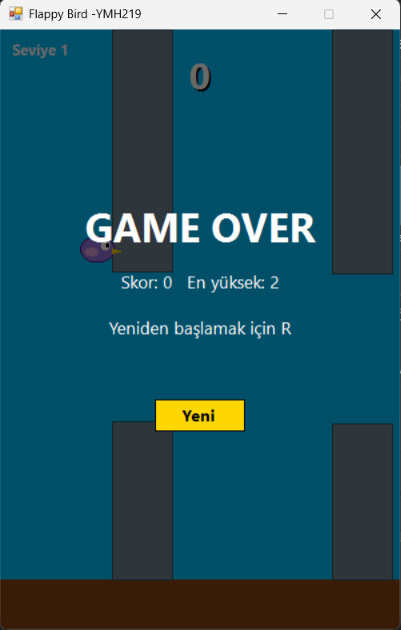

# YMH219-FlappyBird

Nesne Tabanlı Programlama (YMH 219) dersi ek uygulama ödevi için geliştirilen, **Flappy Bird benzeri** bir Windows Forms masaüstü oyunu. Oyuncu, klavye ile mor bir kuşu zıplatarak sağdan sola kayan taş sütunların arasındaki boşluklardan geçirmeye çalışır.

Projenin amacı; Timer ile oyun döngüsü kurmak, klavye olaylarını yakalamak, nesneleri çalışma zamanında hareket ettirmek, çarpışma kontrolü yapmak ve oyun durumunu sınıflarla düzenli şekilde yönetmektir. Oyundaki tüm görseller kod ile çizilmiştir, hazır bir görsel kullanılmamıştır.

## Kullanılan Teknolojiler

- C#
- .NET Framework 4.8
- Windows Forms (`Timer`, `KeyDown`, `Paint`, `Graphics`)
- Visual Studio 2022
- Harici NuGet paketi kullanılmamıştır.

## Kurulum ve Çalıştırma

1. Depoyu klonlayın:
   ```
   git clone https://github.com/ezgiefsa1/YMH219-FlappyBird.git
   ```
2. `YMH219-FlappyBird.slnx` (veya `YMH219-FlappyBird.csproj`) dosyasını Visual Studio ile açın.
3. Bilgisayarda **.NET Framework 4.8** kurulu olmalıdır (Windows 10/11'de varsayılan olarak bulunur).
4. Üst menüden **Başlat** düğmesine veya **F5** tuşuna basın.

## Kontroller

| Tuş | İşlev |
|-----|-------|
| `SPACE` / `Yukarı ok` | Oyunu başlat / zıpla |
| `P` | Duraklat / devam et |
| `R` | Yeniden başlat |
| **Yeni Oyun** butonu | Oyun bittiğinde yeni oyun başlatır |

## Temel Özellikler

- Kuş tuşa basınca yükselir, yer çekimi etkisiyle aşağı düşer (hız + ivme).
- İki engel sağdan sola hareket eder; ekrandan çıkan engel, rastgele boşluk yüksekliğiyle sağdan yeniden konumlandırılır.
- Kuş bir engele veya zemine çarptığında oyun durur ve **Game Over** ekranı gösterilir.
- Geçilen her engel için skor 1 artar.
- **Yeni Oyun** butonu ve `R` tuşu ile oyun yeniden başlatılır, `P` ile duraklatılır.
- Oyunun hız, skor, seviye ve durum bilgileri `GameState` sınıfının özellikleriyle yönetilir.
- **İsteğe bağlı geliştirmeler:**
  - En yüksek skor `%AppData%\YMH219-FlappyBird\highscore.txt` dosyasında saklanır.
  - Her 5 puanda seviye artar ve engellerin hızı yükselir.

## Sınıf Tasarımı

| Sınıf | Görevi |
|-------|--------|
| `Player` | Kuşun konumu, dikey hızı, yer çekimi, zıplama, çarpışma dikdörtgeni ve çizimi |
| `Pipe` | Bir engel çifti (üst + alt sütun): hareket, yeniden konumlanma, çarpışma, "geçildi" bilgisi |
| `GameState` | Skor, en yüksek skor, seviye, hız ve oyun durumu (`Ready`, `Playing`, `Paused`, `GameOver`) |
| `HighScoreManager` | En yüksek skoru dosyaya yazma/okuma, `try-catch` ile hata kontrolü |
| `GameForm` | Timer döngüsü, klavye olayları, çizim ve nesneleri bir araya getirme |

## Ekran Görüntüleri

**Oyun sırasında**


**Game Over ekranı**



## Bilinen Sınırlamalar / Geliştirme Notları

- Ses efekti bulunmamaktadır.
- Pencere boyutu sabittir (400x600), yeniden boyutlandırılamaz.
- Çarpışma kontrolü dikdörtgenler ile yapıldığı için kuşun yuvarlak köşeleri sütuna çok yakın geçtiğinde çarpışma sayılabilir.
- Zorluk seviyesi seçimi yoktur; zorluk skor arttıkça otomatik yükselir.

## Öğrenci Bilgileri

- **Ad Soyad:** Ezgi Efsa Güleç
- **Öğrenci No:** 250541023
